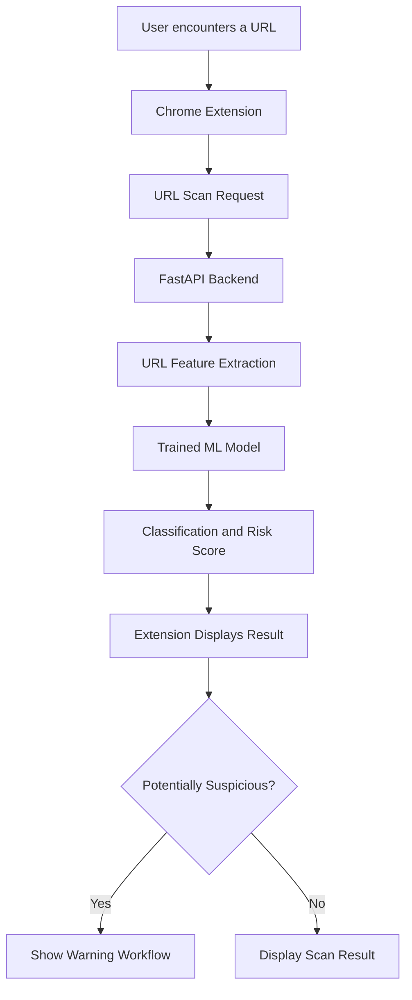

<div align="center">

# 🛡️ URL Sentinel

### AI-Powered Fake URL & Phishing Detection

**Browse smarter. Detect suspicious links. Stay safer online.**

A Chrome Extension powered by machine learning and a FastAPI backend to analyze URLs and identify potentially suspicious websites.

<br/>


</div>

---

## 📌 Overview

**URL Sentinel** is a browser-security project designed to help users recognize potentially dangerous URLs before interacting with suspicious websites.

It combines a Chrome Extension (Manifest V3), a Python FastAPI backend, and a machine-learning classification model. The system extracts URL-based features, evaluates the submitted URL, and returns a classification with a risk score and relevant indicators.

The goal is to make URL security analysis accessible through a simple browser interface while keeping the detection workflow modular and testable.

> **Important:** URL Sentinel provides an automated risk estimate, not a guarantee that a website is safe or malicious.

## ✨ Key Features

- 🔍 **URL Scanning** — Analyze URLs for potentially suspicious patterns.
- 🤖 **Machine-Learning Classification** — Use a trained model to estimate URL risk.
- 📊 **Risk Score** — Present a numerical risk estimate returned by the detection API.
- 🚨 **Suspicious URL Warnings** — Support a warning-page workflow for URLs flagged by the extension.
- 🧩 **Chrome Extension UI** — Popup interface and settings page for browser-based interaction.
- ⚙️ **Configurable Protection** — Extension settings support the project's configured scanning behavior.
- 🧠 **URL Feature Extraction** — Analyze hostname, subdomains, digits, special characters, IP-based hosts, punycode and other lexical indicators.
- 🩺 **Backend Health Check** — Check whether the API service and its model are ready.
- 🧪 **Automated Tests** — Validate URL-feature extraction and API behavior.
- 🧱 **Modular Architecture** — Keep browser UI, API, feature extraction, model training and tests organized separately.

## 🖥️ How It Works



### Detection Workflow

1. **URL input:** The user submits a URL through the extension's supported scanning workflow.
2. **Input validation:** The backend validates the URL and applies its configured request checks.
3. **Feature extraction:** The URL is converted into numerical features.
4. **Model inference:** The trained classifier evaluates the feature vector.
5. **Result generation:** The API returns a classification, risk score and available indicators.
6. **User feedback:** The extension presents the result and follows its configured warning workflow.

Actual protection depends on the extension's implementation, configuration, backend availability and model behavior.

## 🧰 Technology Stack

| Component | Technology |
|---|---|
| Browser integration | Chrome Extension Manifest V3 |
| Extension interface | HTML, CSS, JavaScript |
| Background processing | JavaScript service worker |
| Backend API | Python, FastAPI |
| ASGI server | Uvicorn |
| Machine learning | scikit-learn |
| Data processing | pandas |
| Model serialization | joblib |
| Testing | pytest |
| Development environment | Python virtual environment |

## 📂 Project Structure

```text
fake-url-detection-extension/
│
├── backend/
│   ├── app/
│   │   ├── main.py
│   │   └── ml/
│   └── models/                 # Local trained model artifacts
│
├── extension/
│   ├── manifest.json
│   ├── background/
│   │   └── service-worker.js
│   ├── popup/
│   │   ├── popup.html
│   │   ├── popup.css
│   │   └── popup.js
│   ├── options/
│   │   ├── options.html
│   │   ├── options.css
│   │   └── options.js
│   ├── warnings/
│   │   ├── warning.html
│   │   ├── warning.css
│   │   └── warning.js
│   └── icons/
│
├── ml/
│   ├── train.py
│   ├── evaluate.py
│   └── features.py
│
├── tests/
├── data/                       # Local datasets; not committed
├── .env.example
├── .gitignore
└── README.md
```

*Note: The tree represents the main project organization. Some files may differ as development progresses.*

## ⚙️ Getting Started

### Prerequisites

Install the following before running the project:

- [Google Chrome](https://www.google.com/chrome/)
- Python 3.12 or another compatible Python version
- pip
- Git

### 1. Clone the Repository

Replace the placeholder with your actual GitHub repository URL after publishing the project.

```bash
git clone <YOUR_GITHUB_REPOSITORY_URL>
cd fake-url-detection-extension
```

### 2. Create a Virtual Environment

**macOS / Linux**

```bash
python3 -m venv .venv
source .venv/bin/activate
```

**Windows PowerShell**

```powershell
py -m venv .venv
.venv\Scripts\Activate.ps1
```

### 3. Install Backend Dependencies

The backend dependencies are maintained in `backend/requirements.txt`.

```bash
python -m pip install -r backend/requirements.txt
```


### 4. Configure Environment Variables

Review `.env.example` for the variables required by the current implementation.

Create a local `.env` file only if the application requires it. Use valid local values, and never commit credentials, API keys, tokens or private configuration.

### 5. Prepare the Machine-Learning Model

The backend requires a compatible trained model artifact to perform inference.

If the model artifact is not included in the repository, follow the training workflow using an appropriate dataset and the project's training scripts.

Keep the model's expected feature names, feature order and preprocessing logic consistent between training and inference.

### 6. Start the Backend API

From the project root, activate the virtual environment that contains the backend dependencies and run:

```bash
python -m uvicorn app.main:app --app-dir backend --host 127.0.0.1 --port 8000
```

The local API should be available at:

- **Health check:** http://127.0.0.1:8000/api/v1/health
- **Interactive API documentation:** http://127.0.0.1:8000/docs

The health response should indicate that the model is loaded before model-based scans are expected to work.

### 7. Load the Chrome Extension

1. Open Google Chrome.
2. Navigate to `chrome://extensions`.
3. Enable **Developer mode**.
4. Select **Load unpacked**.
5. Choose the project's `extension/` folder.
6. Open the URL Sentinel popup.
7. Verify the configured backend address and scan a test URL.

Keep the local backend running while testing features that depend on the API.

## 🔌 API Overview

The backend exposes endpoints for health checks, URL scanning and diagnostics.

| Endpoint | Purpose |
|---|---|
| `GET /api/v1/health` | Check service and model readiness |
| `POST /api/v1/scans` | Submit a URL for analysis |
| `GET /api/v1/diagnostics` | Inspect supported connectivity diagnostics |

### Example Scan Request

```bash
curl -X POST http://127.0.0.1:8000/api/v1/scans \
  -H "Content-Type: application/json" \
  -d '{"url":"https://example.com"}'
```

The exact response schema depends on the current API implementation. A successful scan can include a classification, risk score, model version and detection indicators.

**Use only URLs you are authorized to test.** Avoid submitting private URLs containing access tokens or other sensitive information.

## 🧪 Testing

Run the automated test suite from the project root:

```bash
python -m pytest -q
```

The current local test run completed successfully:

```text
6 passed
```

The tests cover URL feature extraction and API behavior. This result does not replace end-to-end browser testing, model validation, security review or deployment testing.

## 📈 Model Training & Evaluation

The `ml/` directory contains the machine-learning workflow.

Typical responsibilities include:

- Preparing URL data for model training.
- Extracting and selecting numerical features.
- Training a classification model.
- Evaluating predictions using classification metrics.
- Saving a model artifact for backend inference.

Use datasets only when you have the right to use and redistribute them. Document dataset provenance, licensing, class balance and evaluation methodology before making performance claims.

Model accuracy alone does not establish real-world phishing detection effectiveness. False positives, false negatives, dataset leakage, distribution shifts and unseen phishing techniques must also be considered.

## 🔐 Security Considerations

Security is a core concern for a browser-protection extension.

- **Least privilege:** Request only the Chrome permissions required by implemented features.
- **Input validation:** Validate URL schemes and reject malformed or unsupported input.
- **Untrusted content:** Treat submitted URLs and remote responses as untrusted data.
- **Secret management:** Keep `.env`, credentials, private keys and access tokens out of Git.
- **Backend exposure:** Keep development services bound to localhost unless remote access is intentionally configured and secured.
- **Model integrity:** Load trusted model artifacts and keep training and inference feature definitions consistent.
- **Privacy:** Avoid unnecessary collection, retention or logging of browsing history and sensitive URL parameters.
- **Safe user decisions:** Do not automatically treat a low risk score as proof of safety.

Before public deployment, review redirect handling, permissions, network requests, API authentication and rate limiting, warning-page behavior, privacy disclosures and failure modes.

## 🛣️ Future Improvements

Potential future enhancements include:

- [ ] Expand automated unit and integration test coverage.
- [ ] Add browser-level end-to-end tests.
- [ ] Improve handling of false positives and false negatives.
- [ ] Add explainable detection indicators and clearer risk communication.
- [ ] Establish repeatable model evaluation and dataset versioning.
- [ ] Add production-grade API authentication, rate limiting and monitoring.
- [ ] Document privacy practices and Chrome Web Store release requirements.
- [ ] Set up continuous integration for tests and code quality checks.

## 🤝 Contributing

Contributions, bug reports and improvement suggestions are welcome.

1. Fork the repository.
2. Create a feature branch.
3. Make a focused change.
4. Run the test suite.
5. Submit a pull request describing the change and its testing.

Please avoid including credentials, private data, large datasets or unrelated generated artifacts in contributions.

## 📄 License

No license has been specified yet. Until a license is added, do not assume that others have permission to redistribute or reuse this project's code. Add an appropriate `LICENSE` file before publishing the repository for open-source reuse.

## ⚠️ Disclaimer

URL Sentinel is a defensive security and educational project. Automated classification can make mistakes and cannot guarantee protection against every phishing attack or malicious website.

Always verify suspicious links independently and avoid sharing passwords, payment details or other sensitive information with untrusted websites.

---

<div align="center">

**Built to make suspicious URLs easier to spot. 🛡️**

</div>
